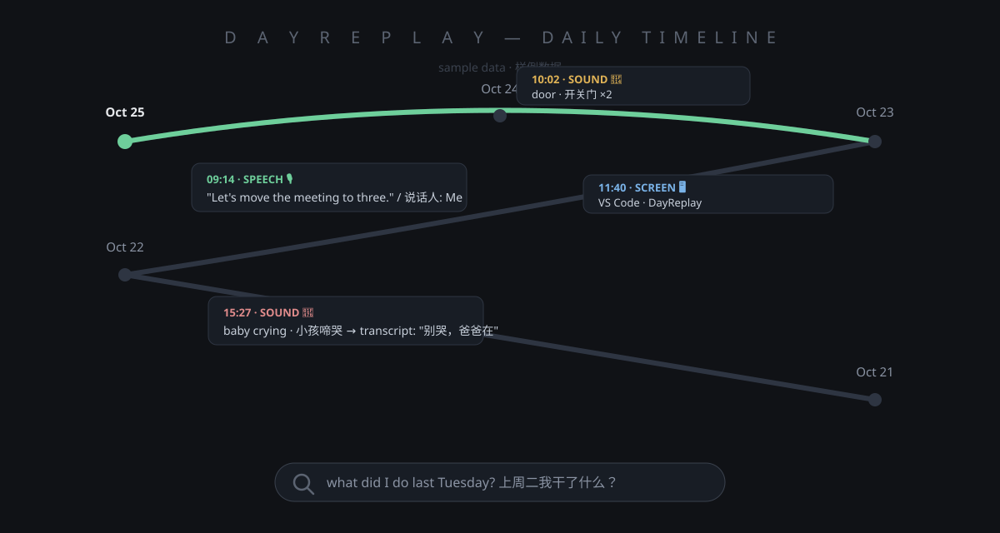

# DayReplay

> **A diary that writes itself.** Everything you say, the sounds around you, and the
> apps you use — on one timeline you can search and replay. Fully offline. Your day
> never leaves your PC.

[中文说明](README.zh-CN.md) · [Roadmap](#roadmap) · [Contributing](#contributing)

<!-- TODO: replace with a real (privacy-safe) screenshot of the S-shaped daily timeline -->


It brings your **microphone**, your **screen**, and your **apps** together into one
aligned timeline — a true, complete record of your day. Missed something? Play it
back anytime, **as clear as the moment it happened**.

Ask *"what did I do last Tuesday?"* — get the answer in seconds, with links back to
the original audio and screen shots.

---

## Why another tracker?

[ActivityWatch](https://github.com/ActivityWatch/activitywatch) writes down window
titles. Rewind and Recall want a Mac or a cloud account. The part they all miss:
**sound**.

| | ActivityWatch | Rewind / Recall | DayReplay |
|---|---|---|---|
| What you **said** (searchable text) | — | paid plan | ✅ |
| Sounds around you (footsteps, doors, water, a baby crying) | — | — | ✅ |
| What was on your screen | window titles only | ✅ (Mac / cloud) | ✅ optional, local |
| Works with no internet at all | ✅ | ❌ | ✅ installer ships all models |
| Price | free | subscription | free, open source |

## What you get

- **Your words, written down** — it listens for speech and turns it into text
  (Mandarin + English), running on a normal CPU, no GPU needed
- **Sounds around you** — footsteps, a chair moving, running water, a door, a baby
  crying. Two-stage filtering keeps quiet hours actually quiet
- **Who said it** — speaker tagging by voice, so the timeline shows who was talking
- **Your screen, optional** — pairs with local screen capture; every entry can link
  to the screen proof of that moment
- **One timeline for the whole day** — a daily page that weaves voice, screen, and
  events together; opens in any browser, nothing to install
- **Ask in plain words** — "did I ever talk about the Vietnam trip?" searches weeks
  of audio and screen history
- **USB-stick install** — copy to a stick, double-click on any Windows 10/11
  64-bit PC. No internet, no Python, no admin rights (~3.5 GB)
- **Self-updating** — version numbers, small incremental updates, a test after every
  update, and automatic rollback if anything goes wrong
- **One-click stop** — the mic is yours: tray icon, kill switch, everything in
  plain sight

## Quick start

1. Download the latest installer from
   [Releases](../../releases) (or copy the `DayReplay` folder to a USB stick, ≥ 4 GB free).
2. On the target PC, double-click **`install.bat`** (one-click install).
3. The installer picks your microphone, sets up autostart, runs a short self-test
   (it really turns a bundled sample into text), then opens your first daily timeline.

First timeline appears within minutes.

<details>
<summary><b>Run from source</b> (developers)</summary>

```text
Windows 10/11 64-bit, Python 3.11
git clone https://github.com/sedlee0811-44/DayReplay.git
python -m venv .venv && .venv\Scripts\pip install -r requirements.txt
python voice_daemon.py        # recorder + speech-to-text + screen watcher
python vdigest.py             # build today's timeline page
```

Note: docs under `docs/` are in Chinese (English translation welcome — a great
first contribution).

</details>

## How it works

```text
 microphone ──► voice detect ──► speech-to-text (SenseVoice) ──► text (zh/en)
     │               │                        │
     │               ├─ DSP gate ──► sound classifier (AudioSet, 527 kinds) ──► events
     │               └─ voice print (CAM++) ──► who is speaking
 screen (optional) ──► OCR / key frames ──┐
                                          ▼
                      SQLite (all local) ──► daily HTML timeline
                                          ▼
                      plain-language search ──► transcript pages
```

- Speech-to-text: [FunASR / SenseVoice-Small](https://github.com/FunAudioLLM/SenseVoice)
  (Chinese + English, real time on CPU)
- Sound events: [AST AudioSet](https://github.com/YuanGongND/ast) classifier over a
  hand-tuned DSP pre-filter
- Speaker tagging: CAM++ voice embeddings
- Everything else: plain Python + SQLite, no framework

## Privacy & consent

- **All data stays on your machine.** No telemetry, no cloud calls, no accounts.
  The only network access ever performed is *you* checking for updates from a
  source you configured.
- The microphone records **your own device, with your knowledge** — a tray icon,
  a running indicator, and a one-click stop are built in.
- Recording other people without their consent is against the law in many places.
  This tool is made for your own computer and your own day. Please check your
  local laws and respect the people around you.
- Delete anything anytime: audio, transcripts, and timelines are plain files plus
  one SQLite database.

## Roadmap

- [ ] English UI (the app is Simplified Chinese today; speech recognition already
      handles both zh and en)
- [ ] Pause schedules and meeting mode
- [ ] macOS / Linux support
- [ ] More spoken languages (zh + en only for now, by design)
- [ ] Plugin API for custom watchers

## Contributing

Issues and pull requests are welcome — especially from English speakers. Right now
the fastest ways to help:

1. **Translate docs** (`docs/` is Chinese; READMEs are bilingual)
2. **Test the installer on your machine** and report what breaks
3. Grab a `good first issue`

See [CONTRIBUTING.md](CONTRIBUTING.md).

## License

MIT for the code. Bundled models (SenseVoice, CAM++, AST) keep their upstream
licenses — see `models/LICENSES.md`.
