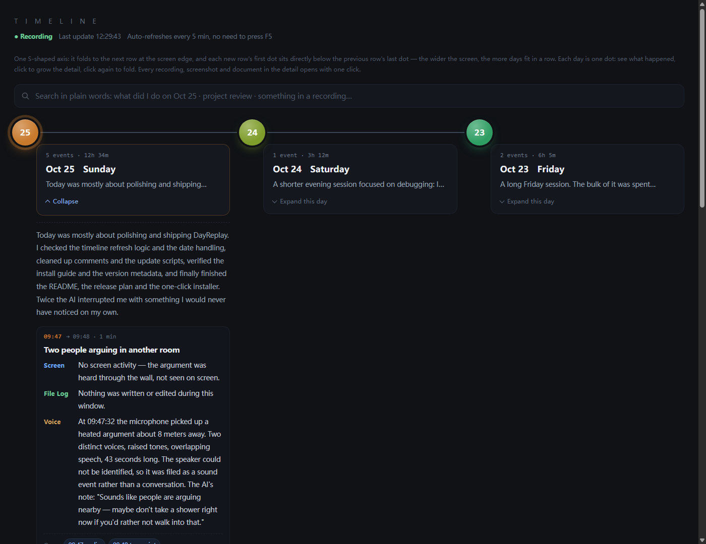

# DayReplay · 一本自己会写的日记

> **你说的话、身边的声音、用过的应用，都在一条可搜索的时间轴上。**
> **随时回放——像再次发生一样清晰。**
>
> 全程离线，数据不出电脑。

[English](README.md) · [Roadmap](#路线图) · [参与贡献](#参与贡献)



DayReplay 把**麦克风拾音、屏幕画面、用过的应用**融合对齐到同一条时间轴上——
真实、完整地记录你这一天做了什么。哪天想不起来？随时回放，
**像再次发生一样清晰**。

**"上周二我干了什么？"——几秒钟出答案**，还能点回当时的原始录音和屏幕截图。

---

## 为什么再造一个轮子？

[ActivityWatch](https://github.com/ActivityWatch/activitywatch) 只记录窗口标题；
Rewind、Recall 这类"AI 记忆"工具要么 Mac 专属、要么要联网。
它们都缺的那一块：**声音**。

| | ActivityWatch | Rewind / Recall | DayReplay |
|---|---|---|---|
| 你**说过的话**（可搜索的文字） | — | 付费版有 | ✅ |
| 身边的声音（脚步、开关门、流水、孩子啼哭） | — | — | ✅ |
| 屏幕上出现过的内容 | 仅窗口标题 | ✅（Mac / 云） | ✅ 可选、本地 |
| 完全断网也能用 | ✅ | ❌ | ✅ 核心全程离线；模型首次联网下载一次 |
| 价格 | 免费 | 订阅 | 免费开源 |

## 你能得到什么

- **你说的话，自动写成文字** —— 常驻语音检测 + SenseVoice 识别
  （普通话 + 英语），普通 CPU 就能实时跑，不需要显卡
- **身边的声音** —— 走动、挪椅子、水龙头、开关门、孩子啼哭……
  两级过滤，安静的时候就安安静静，不会乱报
- **谁在说话** —— 按声纹标注说话人，时间轴一目了然
- **屏幕记忆（可选）** —— 与本地录屏配合，每条记录都能点回当时的屏幕证据
- **一整天的同一条时间轴** —— 每天生成一页：语音 + 屏幕 + 声音事件交织在一起，
  任何浏览器直接打开，不用装任何东西
- **用大白话搜索** —— "越南改革的事我哪天聊过？"跨周检索录音和屏幕
- **U 盘便携安装** —— 拷进 U 盘，任何 Windows 10/11 64 位电脑双击即装；
  免预装 Python、免管理员（核心约 330 MB，模型约 1.3 GB 首次联网下载）
- **自动更新** —— 语义化版本号、增量更新、每次更新后自动测试、出问题自动回滚
- **一键停止** —— 麦克风永远归你：托盘图标、停止开关，一切都在明处

## 快速开始

1. 到 [Releases](../../releases) 下载 `DayReplay-<版本>-lite-win64.zip`
   （**约 330 MB**），解压到任意目录。
2. 在目标电脑上双击 **`install.bat`**（一键安装，免管理员、免预装 Python）。
3. 安装器会问你要不要**从 HuggingFace 下载 AI 模型**（免费开源，约 1.3 GB）
   —— 可以先跳过，之后手动跑 `download_models.py`。这是唯一需要联网的一次。
4. 装完自动选麦克风、注册开机自启、跑一遍自检（真把一段自带录音转成文字），
   然后打开你的第一份时间轴。

几分钟内就能看到第一条时间轴。模型下完之后，**此后全程离线**。

> **完全不想联网？** 有含模型的"完整版"（约 3.4 GB），拷 U 盘插上就能用，
> 一次网都不需要 —— 需要的话找我拿。

<details>
<summary><b>从源码运行</b>（开发者）</summary>

```text
Windows 10/11 64 位，Python 3.11
git clone https://github.com/sedlee0811-44/DayReplay.git
python -m venv .venv && .venv\Scripts\pip install -r requirements.txt
python voice_daemon.py        # 录音 + 语音转写 + 屏幕监视
python vdigest.py             # 生成当日时间轴页面
```

完整架构（守护进程、VAD 分段、DSP 特征闸门、声音事件分类、总账渲染、
更新系统）见 `docs/` 下的《使用手册》与《代码档案》。

</details>

## 工作原理

```text
 麦克风 ──► 语音检测 ──► 语音段 ──► SenseVoice 识别 ──► 文字（中/英）
   │             │                     │
   │             ├─ DSP 闸门 ──► 声音分类（AudioSet 527 类）──► 活动声事件
   │             └─ CAM++ 声纹 ──► 谁在说话
 屏幕（可选）──► OCR/关键帧 ────────┐
                                    ▼
                     SQLite（全本地）──► 每日 HTML 时间轴
                                    ▼
                     自然语言搜索 ──► 文字稿页面
```

- 语音识别：[FunASR / SenseVoice-Small](https://github.com/FunAudioLLM/SenseVoice)
  （中英，CPU 实时）
- 声音事件：[AST AudioSet](https://github.com/YuanGongND/ast) 分类器 + 手调 DSP 预筛
- 说话人：CAM++ 声纹嵌入
- 其余全部：纯 Python + SQLite，无框架

## 隐私与授权

- **所有数据只存在你自己的电脑上。** 没有遥测、没有云调用、没有账号。
  唯一的网络访问是你主动配置更新源去检查更新。
- 麦克风录的是**你自己的设备、且你自己知情**——托盘图标、运行指示、
  一键停止都是内置的。
- 在许多国家和地区，未经他人同意录音是违法的。本工具为你自己的电脑和
  你自己的一天而设计；请了解并遵守当地法律，尊重身边的人。
- 随时删除任何东西：录音、文字稿、时间轴都是普通文件 + 一个 SQLite 数据库。

## 路线图

- [ ] 英文界面 —— i18n 层已搭好（`vlang.py`，`DAYREPLAY_LANG=en` 切换），
      但默认仍是中文，目前只翻译了时间轴页。**这是最好的入门贡献。**
- [ ] 暂停/恢复计划、会议模式
- [ ] macOS / Linux 支持
- [ ] 更多识别语种（当前按设计只支持普通话 + 英语）
- [ ] 自定义监视器的插件 API

## 参与贡献

欢迎 Issue 和 PR。现在最需要帮忙的三件事：

1. **翻译文档**（`docs/` 目前是中文；两份 README 已双语）
2. **在你的机器上实测安装器**，报告问题
3. 认领 `good first issue` 标签的任务

详见 [CONTRIBUTING.md](CONTRIBUTING.md)。

## 许可证

本项目代码采用 MIT。内置模型（SenseVoice、CAM++、AST）各自遵循其上游许可，
见 `models/LICENSES.md`。
